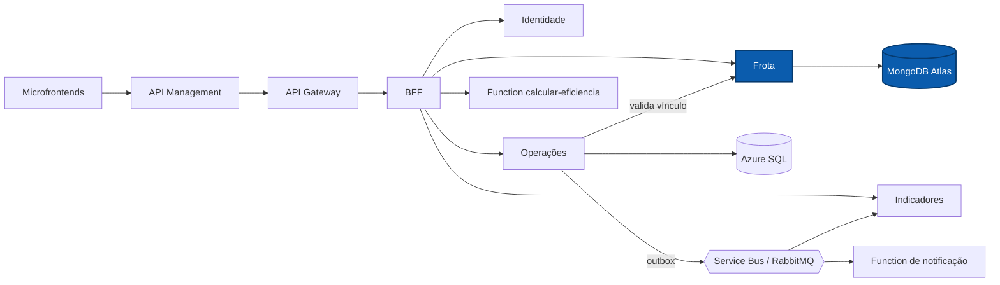

# NexFleet Frota

Microsserviço de cadastro da frota do NexFleet: veículos, motoristas e o histórico de vínculos entre eles, persistidos no MongoDB Atlas.

[](https://github.com/mateusblm/nexfleet-frota/actions/workflows/ci.yml)
[](https://hub.docker.com/r/mateusblm/nexfleet-frota)


---

## Visão geral

O NexFleet é uma plataforma de gestão de frotas empresariais: veículos, motoristas, vínculos, abastecimentos, manutenções, painel de custos e uma visão consolidada de eficiência.

**Frota** é o dono dos dados cadastrais da frota. Persiste no **MongoDB Atlas** (coleções `veiculos`, `motoristas` e `vinculos`) e atende o BFF (cadastros, painel e `GET /aggregated-data`) e o serviço de Operações, que valida o vínculo motorista ↔ veículo antes de aceitar um abastecimento. Todas as rotas exigem o JWT emitido pela Identidade.



## Funcionalidades

- Veículos: cadastrar, editar, consultar, listar com filtro por status e paginação, inativar e excluir definitivamente.
- Status de veículo: `DISPONIVEL`, `EM_USO`, `EM_MANUTENCAO` e `INATIVO`.
- Motoristas: cadastrar, editar, consultar, listar com filtro por status (`ATIVO`, `INATIVO`) e excluir definitivamente.
- Placa, CPF e CNH únicos, garantidos por índices do MongoDB criados na inicialização.
- Vínculos motorista ↔ veículo com histórico: criar e encerrar; um único vínculo ativo por veículo, garantido por índice único parcial mesmo sob concorrência.
- Vínculo recusado para veículo ou motorista inativo e para CNH vencida.
- Validação de vínculo para operação, consumida por Operações no registro de abastecimentos.
- Exclusão definitiva apenas de registros inativos e sem histórico.
- Readiness ligado ao MongoDB: sem banco, responde `503`.

## Arquitetura

**Clean Architecture + Vertical Slice.** Cada caso de uso é uma fatia em `br.com.nexfleet.frota`, com as camadas `api`, `application` e `infrastructure` (adaptadores MongoDB); o domínio fica em `veiculo/domain` e `motorista/domain`.

| Fatia | Responsabilidade |
|---|---|
| `gerenciarveiculos` | Cadastrar, editar, consultar, inativar e excluir veículos |
| `gerenciarmotoristas` | Cadastrar, editar, consultar e excluir motoristas |
| `gerenciarvinculos` | Criar, encerrar, listar e validar vínculos para operação |
| `consultarservico` | Informações do serviço |
| `veiculo/domain`, `motorista/domain` | Modelo de domínio (status de veículo e de motorista) |

Pacotes técnicos: `infrastructure` (criação dos índices do MongoDB), `config` (segurança, JWKS, OpenAPI e composição) e `observability` (correlação).

Regras verificadas pelo ArchUnit (`ArchitectureTest`):

- MongoDB (`org.springframework.data.mongodb`, `com.mongodb`, `org.bson`) só em `infrastructure`;
- `domain` não depende de Spring, Jakarta nem das camadas `application`, `api` e `infrastructure`;
- `application` não depende de framework nem de adaptadores;
- `api` não acessa a persistência diretamente;
- nenhuma classe importa código interno de outros serviços.

## API

Rotas internas do serviço. A aplicação web as consome pelo BFF, que as expõe sem o prefixo `/frota`.

| Método | Rota interna | Exposta pelo BFF como | Descrição |
|---|---|---|---|
| `GET` | `/api/v1/frota/veiculos?status=&pagina=&tamanho=` | `GET /api/v1/veiculos` | Listar veículos (padrão: página 0, 20 itens) |
| `GET` | `/api/v1/frota/veiculos/{id}` | `GET /api/v1/veiculos/{id}` | Consultar veículo |
| `POST` | `/api/v1/frota/veiculos` | `POST /api/v1/veiculos` | Cadastrar veículo |
| `PUT` | `/api/v1/frota/veiculos/{id}` | `PUT /api/v1/veiculos/{id}` | Editar veículo |
| `DELETE` | `/api/v1/frota/veiculos/{id}` | `DELETE /api/v1/veiculos/{id}` | Inativar veículo |
| `DELETE` | `/api/v1/frota/veiculos/{id}/definitivo` | `DELETE /api/v1/veiculos/{id}/definitivo` | Excluir veículo inativo e sem histórico |
| `GET` | `/api/v1/frota/motoristas?status=&pagina=&tamanho=` | `GET /api/v1/motoristas` | Listar motoristas |
| `GET` | `/api/v1/frota/motoristas/{id}` | `GET /api/v1/motoristas/{id}` | Consultar motorista |
| `POST` | `/api/v1/frota/motoristas` | `POST /api/v1/motoristas` | Cadastrar motorista |
| `PUT` | `/api/v1/frota/motoristas/{id}` | `PUT /api/v1/motoristas/{id}` | Editar motorista |
| `DELETE` | `/api/v1/frota/motoristas/{id}/definitivo` | `DELETE /api/v1/motoristas/{id}/definitivo` | Excluir motorista inativo e sem histórico |
| `GET` | `/api/v1/frota/vinculos?veiculoId=&pagina=&tamanho=` | `GET /api/v1/vinculos` | Listar vínculos |
| `POST` | `/api/v1/frota/vinculos` | `POST /api/v1/vinculos` | Criar vínculo |
| `PUT` | `/api/v1/frota/vinculos/{id}/encerramento` | `PUT /api/v1/vinculos/{id}/encerramento` | Encerrar vínculo |
| `GET` | `/api/v1/frota/vinculos/validacao-operacao?veiculoId=&motoristaId=&realizadoEm=` | — (usada por Operações) | Validar vínculo em uma data |
| `GET` | `/api/v1/frota/info` | — | Informações do serviço |

O OpenAPI do serviço é publicado em `/v3/api-docs` e reunido na Swagger UI do Gateway: **[Swagger UI em produção](https://apim-nexfleet-homolog-ukzjodf42myfe.azure-api.net/swagger-ui.html)** (seletor "Frota").

## Stack

| Camada | Tecnologia | Versão |
|---|---|---|
| Linguagem | Java | 21 |
| Framework | Spring Boot (Web MVC, Security, OAuth2 Resource Server, Actuator) | 4.1.1 |
| Banco de dados | MongoDB Atlas (nuvem) / MongoDB 7.0 (local), Spring Data MongoDB | — |
| Documentação | springdoc-openapi (`/v3/api-docs`) | 3.2.0 |
| Observabilidade | Micrometer + Prometheus | gerenciada pelo Spring Boot |
| Testes | JUnit 5, Testcontainers (MongoDB), ArchUnit | 5 / — / 1.4.1 |
| Build | Maven Wrapper | 3.9.16 |
| Contêiner | `eclipse-temurin:21-jre-jammy` | 21 |
| CI/CD | GitHub Actions → Docker Hub | — |

## Primeiros passos

### Pré-requisitos

- JDK 21 (o Maven vem pelo wrapper `./mvnw`)
- Docker, para os testes de integração (Testcontainers) e para executar a imagem

### Testes

```bash
./mvnw -B -ntp verify
```

### Executar com Docker

```bash
docker run --rm -p 8082:8080 \
  -e SPRING_PROFILES_ACTIVE=jwt-rsa \
  -e MONGODB_URI="mongodb://<usuário>:<senha>@<host>:27017/?authSource=admin" \
  -e MONGODB_DATABASE=frota \
  -e IDENTIDADE_URL=http://<host-da-identidade>:8080 \
  mateusblm/nexfleet-frota:v1.0.0
```

Para gerar a imagem a partir do código: `docker build -t mateusblm/nexfleet-frota:local .`

### Ambiente completo

O produto inteiro (todos os serviços, SQL Server, MongoDB e RabbitMQ) sobe pelo repositório [nexfleet](https://github.com/mateusblm/nexfleet):

```bash
git clone https://github.com/mateusblm/nexfleet.git && cd nexfleet
scripts/clonar-tudo.sh                                        # clona os demais repositórios ao lado
scripts/iniciar-local.sh                                      # gera o .env e a chave RSA local
docker compose -f compose.yaml -f compose.build.yaml up -d --build
scripts/seed-demo.sh                                          # dados de demonstração
```

## Configuração

| Variável | Descrição | Padrão |
|---|---|---|
| `PORT` | Porta HTTP | `8080` |
| `SPRING_PROFILES_ACTIVE` | `jwt-rsa` valida o token pela JWKS da Identidade | — |
| `MONGODB_URI` | String de conexão do MongoDB; contém credenciais | obrigatória |
| `MONGODB_DATABASE` | Banco do MongoDB | `frota` |
| `IDENTIDADE_URL` | URL da Identidade (JWKS) | `http://localhost:8081` |

## Ambiente em nuvem

| Recurso | Endereço |
|---|---|
| Aplicação | https://white-mushroom-0cadda010.3.azurestaticapps.net |
| API (Azure API Management) | https://apim-nexfleet-homolog-ukzjodf42myfe.azure-api.net |
| Swagger UI | https://apim-nexfleet-homolog-ukzjodf42myfe.azure-api.net/swagger-ui.html |
| AsyncAPI dos eventos | https://white-mushroom-0cadda010.3.azurestaticapps.net/docs/eventos/ |
| Imagem Docker | https://hub.docker.com/r/mateusblm/nexfleet-frota |

Frota roda em Azure Container Apps, sem URL pública própria, com dados no MongoDB Atlas.

> Os serviços escalam a zero quando ociosos. A primeira requisição após um período de inatividade pode levar de 1 a 2 minutos.

## Testes

| Tipo | Exemplos | O que cobre |
|---|---|---|
| Unitários | `GerenciarVeiculosTest`, `GerenciarMotoristasTest`, `GerenciarVinculosTest` | Regras de cadastro, CNH vencida, vínculo ativo único, encerramento |
| API | `VeiculosHttpTest`, `MotoristasHttpTest`, `VinculosHttpTest`, `VeiculosInjecaoHttpTest` | Contratos HTTP, autenticação e entradas maliciosas |
| Integração (Testcontainers, MongoDB) | `MongoVeiculosIT`, `MongoMotoristasIT`, `MongoVinculosIT`, `FrotaMongoIT`, `FrotaVinculosMongoIT` | Persistência e índices em MongoDB real |
| Arquitetura (ArchUnit) | `ArchitectureTest` | Dependências entre camadas, MongoDB só em `infrastructure` |

```bash
./mvnw -B -ntp verify     # testes de integração exigem Docker
```

O CI (`.github/workflows/ci.yml`) executa `verify` a cada push e pull request; em tags `v*`, publica `mateusblm/nexfleet-frota:<tag>` e `:latest` no Docker Hub.

## Equipe

- Vinícius dos Reis Góes
- Mateus Burlamaqui
- Lucas Roussenq
- Erik Carvalho
